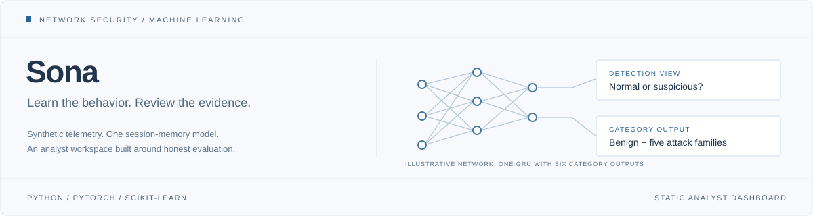
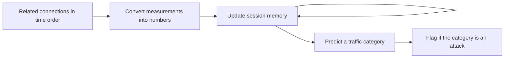

  

<strong>Learned detection · Session memory · Inspectable evidence</strong>

  <a href="Download_Project_Here.html">Download Project Here</a> ·
  <a href="#how-sona-works">How Sona works</a> ·
  <a href="#project-map">Project map</a> ·
  <a href="KNOWLEDGE.md">Technical reference</a>

---

**Sona** is an educational intrusion detection model built with Python and PyTorch. It reads related network connections in chronological order, learns patterns across a session, and predicts normal activity or one of five simulated attack categories: port scanning, authentication brute force, beaconing, service floods, and outbound transfers.

**[Download Project Here](Download_Project_Here.html)** contains the complete interactive dashboard and its saved showcase data in one HTML file. The [technical reference](KNOWLEDGE.md) covers architecture, evaluation, development, and reproduction.

## How Sona works

**Measurements supply the evidence.** Inputs describe connection duration, ports, packets, bytes, protocol, service, outcome, and timing. Labels, IP addresses, host identities, and generator bookkeeping stay out of the learned inputs.

**Memory connects events.** Sona uses a gated recurrent unit, or **GRU**: a neural component that updates a compact summary as each connection is read. Its 32 memory values work together to retain useful context. That summary starts fresh for each session; it is not a permanent history of a host.

**One network makes the decision.** After reading the session, an output layer produces scores for six categories. Softmax converts the scores into a distribution. The highest-scoring category supplies both the predicted behavior and whether the session is flagged. Every displayed flow in that session inherits this prediction.

**Training learns the connections.** Generated examples come with known answers. A loss function measures prediction error; backpropagation calculates how changes to the network’s weights would affect that error. An optimizer applies small updates. Separate validation sessions select the checkpoint, and held-out test sessions measure its performance. Preprocessing is fitted on training data only.

## Why add sequence memory?

Beta 1 and Beta 2 classify individual connections, then combine their answers by voting. Beta 2 broadens attack training. Beta 3 introduces session memory; Sona combines memory with broader training.

That architecture can relate individually weak clues across time. For example, repeated authentication failures followed by a large transfer may deserve a different interpretation from either activity alone. This is a motivation for sequence modeling, not a claim that the saved model has been validated on that exact scenario.

The progression benchmark demonstrates learned sequence recognition, but Sona does not win every test. On the original shared standard and lower-rate session tests, Sona and Beta 2 tie. Retrained research models and the saved dashboard checkpoint are separate artifacts. See the [matched comparison](docs/FOUR_MODEL_COMPARISON.md) and [independent evaluation](docs/SONA_EVALUATION.md) for results and limitations.

## The dashboard

| Page | Purpose |
| --- | --- |
| **Overview** | Saved predictions, detection measurements, classification errors, and investigation records |
| **Sona explained** | An interactive diagram of ordered inputs, memory, and outputs |
| **Sona Progression** | Shared-test comparisons and why the model design changed |
| **Neural networks explained** | A beginner walkthrough of individual neurons and editable connection weights |
| **Browse full dataset** | Search and inspect all 87,505 bundled connection records |

The dashboard is a static presentation of saved results. The teaching network calculates its own illustrative responses in the browser; it does not run or modify the saved Sona detector. Displayed evaluation metrics count flows that share session decisions, rather than independent predictions for every connection.

## Project map

| Location | Responsibility |
| --- | --- |
| [`src/ids_ml/data/`](src/ids_ml/data/) | Synthetic traffic generation, schema, and session splits |
| [`features.py`](src/ids_ml/features.py) | Preprocessing and timing representations |
| [`models/`](src/ids_ml/models/) | Neural architectures, training, and evaluation |
| [`report.py`](src/ids_ml/report.py) | Saved model results and dashboard exports |
| [`alerts.py`](src/ids_ml/alerts.py) | Alert storage and incident grouping |
| [`experiments/`](src/ids_ml/experiments/) | Controlled research studies and artifact audits |
| [`tests/`](tests/) | Python regression checks |
| [`ui/`](ui/) | Dashboard pages, browser data, UI checks, and standalone packaging |
| [`KNOWLEDGE.md`](KNOWLEDGE.md) | Detailed technical reference and reproduction workflow |
| [`Download_Project_Here.html`](Download_Project_Here.html) | Self-contained downloadable dashboard |

Traffic and attack labels are synthetic. These experiments do not establish production intrusion detection accuracy. Sona does not capture live packets, block attacks, or determine malicious intent from traffic alone. Python source is versioned; local environments, generated backend data, model artifacts, and agent coordination files are excluded from Git.
