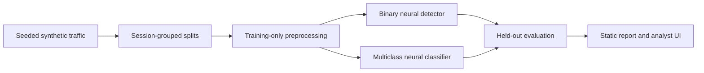

<p align="center">
  
</p>

<p align="center">
  <strong>Learned detection · Reproducible experiments · Transparent results</strong>
</p>

<p align="center">
  <a href="#explore-the-dashboard">Explore</a> ·
  <a href="#how-it-learns">How it learns</a> ·
  <a href="#what-the-models-decide">Model decisions</a> ·
  <a href="#model-versions-v1-v2-v3">Model versions</a> ·
  <a href="#project-map">Project map</a>
</p>

---

**IDS-ML-Project** is an educational intrusion detection simulation. Python generates network activity, small PyTorch networks learn its behavioral patterns, and a static analyst interface makes the results inspectable.

The goal is to evaluate learned combinations of signals alongside a simple rule baseline—showing detections, normal traffic, false alarms, and missed attacks.

## Explore the dashboard

```bash
cd ui
npm run dev
```

Open **[localhost:4173](http://localhost:4173)**. Requires Node.js and Python 3; no UI dependency installation or model server is needed.

| Workspace | What you can inspect |
| --- | --- |
| **Alerts & incidents** | Inline investigations, model scores, predicted families, and session links |
| **Raw data** | The complete bundled dataset, paginated with search, filters, and sortable columns |
| **Model evaluation** | Neural-versus-rule performance, per-class results, and classification errors |

The interface distinguishes **generated ground truth**, **model predictions**, and **rule comparisons**. It reviews precomputed results; it does not train or capture traffic in the browser.

## How it learns



**Examples come with answers.** The generator creates benign activity, port scans, authentication brute force, beaconing, service floods, and outbound-transfer scenarios. Labels supervise training; they never enter the model as input features.

**Behavior becomes numbers.** Durations, ports, packet/byte counts, protocol, service, outcome, and supported timing features form the input. Numeric fields are standardized; categories are encoded. IP addresses, host IDs, and generator bookkeeping are excluded.

**Prediction improves through feedback.** Each network uses two hidden layers—32 and 16 neurons by default. Training compares predictions with labels, then backpropagation and Adam adjust its connections. Dropout and validation-based early stopping help limit overfitting.

| Two kinds of weights | Their job |
| --- | --- |
| **Learned connection weights** | Discover combinations of features that distinguish behaviors |
| **Class weights** | Give underrepresented classes more influence in the training loss |

The binary loss balances suspicious examples against normal examples. Multiclass weights use inverse class frequency. **Rarity changes training emphasis, not alert severity.**

## What the models decide

| Model | Question | Output |
| --- | --- | --- |
| **Binary detector** | Does this flow look suspicious? | A score compared with a threshold, normally `0.5` |
| **Multiclass classifier** | Which learned behavior does it resemble? | Benign or one of five attack families, with a softmax confidence score |

These are **separately trained models**, so their answers can disagree. The binary detector triggers alerts; the multiclass model supplies a family prediction. Session aggregation, confidence-based severity, and incident grouping remain deterministic backend operations. Rules are a comparison baseline, not the primary detector.

Evaluation separates whole sessions across training, validation, and testing, with scenario-aware allocation where enough sessions exist. Precision, recall, F1, false-positive rates, and confusion matrices expose both successes and mistakes. Macro F1 gives each class equal importance.

> **Research boundary:** synthetic performance does not establish production IDS accuracy. Confidence is not a guarantee, and these models classify generated behavior—not specific software vulnerabilities. Robustness, unknown-class handling, calibration, and sequence modeling are ongoing work.

## Model versions (v1, v2, v3)

Instead of just retraining the model over and over and overwriting it, we keep each attempt around so we can actually measure whether a change helped—not just assume it did. So far there are three versions:

| Version | What it is | What changed from the last one |
| --- | --- | --- |
| **v1** | The starting point. | — (baseline) |
| **v2** | The same model design as v1. | Trained on a mix of normal attacks *and* "stealth mode" versions of them—the same attacks, just slowed down and spread out to avoid standing out, the way a real attacker might try to sneak past detection. |
| **v3** | A different kind of model. | Instead of looking at one network connection ("flow") at a time, it looks at a whole group of related connections in order, like watching a short clip instead of a single snapshot. We used a small **GRU** (a type of neural network built to remember what it saw a moment ago, so it can notice patterns *over time*, not just in one instant) to do this. |

**What we found when we tested all three against sneaky, slowed-down attacks:**

- **v1** struggled—it only caught the sneaky versions a little better than half the time, even though it was very good at catching the normal, non-sneaky versions of the same attacks.
- **v2** (trained on some sneaky examples) caught nearly all of them. Giving the model better examples to learn from fixed most of the problem.
- **v3** (never trained on a single sneaky example—same training as v1) *still* did noticeably better than v1. Just being able to see a sequence of connections instead of one at a time gave it some natural resistance to the sneaky pacing trick, for free. The improvement was smaller than v2's and bounced around a bit between test runs (we only had a small number of test examples at this level, so the exact number isn't perfectly stable), but v3 beat v1 every single time we checked.

The takeaway: there are two different ways to make this kind of model better—give it better examples to learn from (v2), or give it a better "view" of the data (v3). Neither one replaces the other; both are real, independent improvements, and both are saved on disk separately so we can always go back and compare them later.

## Project map

| Location | Responsibility |
| --- | --- |
| [`src/ids_ml/data/`](src/ids_ml/data/) | Scenario generation, schema, provenance, and dataset splitting |
| [`features.py`](src/ids_ml/features.py) · [`models/`](src/ids_ml/models/) | Preprocessing, neural architectures, training, and evaluation |
| [`versions.py`](src/ids_ml/versions.py) | Trains and compares v1/v2/v3 side by side on the same held-out data |
| [`inference.py`](src/ids_ml/inference.py) · [`alerts.py`](src/ids_ml/alerts.py) | Model scoring and alert/incident records |
| [`report.py`](src/ids_ml/report.py) · [`ui/`](ui/) | Precomputed report contract and static presentation |

Backend checks use the project's configured environment:

```bash
.venv/bin/python -m pytest
```

Dashboard checks: `cd ui && npm run check`. See the [UI guide](ui/README.md) for data refresh and Vercel setup. Bundled results are snapshots; backend changes do not automatically update the dashboard.

---

[Product vision](docs/PRODUCT_VISION.md) · [Agent workflow](AGENTS.md) · [Current handoff](docs/HANDOFF.md)

Agents read these documents and the Git-kb workspace before changing shared files.
