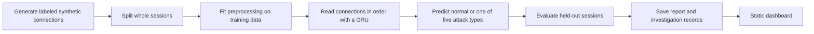

<p align="center">
  
</p>

<p align="center"><strong>Learned detection · Session memory · Inspectable evidence</strong></p>
<p align="center">
  <a href="#explore">Dashboard</a> ·
  <a href="#how-sona-learns">How it learns</a> ·
  <a href="#why-session-memory">Sona Progression</a> ·
  <a href="KNOWLEDGE.md">Technical reference</a>
</p>

---

**Sona** is an educational intrusion detection model built with Python and PyTorch. It reads related network connections in sequence to distinguish normal activity from five simulated attack types. A static dashboard presents the saved predictions, measurements, and investigation records.

The traffic is synthetic. The project studies learned detection behavior; it does not capture live packets, block attacks, or establish real-world detection accuracy.

## Explore

**[Download Project Here](Download_Project_Here.html)** — download the HTML file, then open it in your browser. It includes all five dashboard pages and the complete showcase dataset; no installation is needed. On GitHub, open the file and choose **Download raw file**.


```bash
cd ui
npm run dev
```

Open **[localhost:4173](http://localhost:4173)**. Preview requires Node.js and Python 3, with no UI dependency installation or model server.

| Page | What it shows |
| --- | --- |
| **Overview** | Detection performance, classification results, dataset summary, alerts, and incidents |
| **Sona explained** | An interactive neural diagram and plain explanations of inputs, memory, and training |
| **Sona Progression** | What changed between Beta 1, Beta 2, Beta 3, and Sona, with matched experimental results |
| **Neural networks explained** | A beginner walkthrough with individual neurons, editable connections, and a simple explanation of learning |
| **Browse full dataset** | All 87,505 bundled connection records, with search, filters, sorting, and pagination |

The interface separates **generated ground truth** from **model predictions**. It supports phone layouts and touch explanations. It displays precomputed results; training does not happen in the browser.

## How Sona learns



**Examples have known answers.** Python generates normal traffic, port scans, authentication attacks, beaconing, service floods, and outbound transfers. Those categories supervise training but never enter the network as input features.

**Connections become numbers.** The inputs describe duration, ports, packets, bytes, protocol, service, outcome, and the gap since the previous connection. Numeric fields are standardized and categories are encoded. IP addresses, host identities, and generator bookkeeping are excluded from model inputs.

**Memory adds context.** A GRU, or *gated recurrent unit*, updates a small internal summary as it reads related connections. Sona uses one GRU layer with 32 memory units, followed by a six-category output layer. This gives it a view of both individual measurements and their sequence.

**Training adjusts weights.** An error score compares each prediction with the known category. Backpropagation calculates weight adjustments, and the Adam optimizer applies them. Class weights give less common training categories more influence. Validation loss selects the saved checkpoint; separate test sessions measure its performance.

### One network, two views of its answer

Current Sona predicts a single category for each complete session. If the winning category is `benign`, the session is left unflagged. Any attack category flags it and supplies the predicted attack type.

Its suspiciousness score is `1 − P(benign)`. That score describes the output; the current alert decision comes from the winning category, rather than a separate binary detector. Each displayed flow inherits its session's prediction.

Earlier code also supports two separately trained connection-level networks, one binary and one multiclass. **That earlier design is not the current Sona dashboard pipeline.** Alert aggregation, confidence-based severity, and incident grouping remain deterministic processing around the learned prediction.

## Why session memory?

| Display name | Internal key | Model view | Ordinary attack training |
| --- | --- | --- | --- |
| **Beta 1** | `v1` | One connection at a time | Standard variants |
| **Beta 2** | `v2` | One connection at a time | Standard and lower-rate variants |
| **Beta 3** | `v3` | Ordered connections with GRU memory | Standard variants |
| **Sona** | `v4` | Ordered connections with GRU memory | Standard and lower-rate variants |

Lower-rate attacks use fewer connections, longer gaps, or lower throughput. They can still contain recognizable clues within individual connections. Memory is most useful when the **order of events** carries information that individual measurements cannot reveal.

The progression page compares **retrained counterparts** on the same test sessions across three seeds. All received shared timing practice. These are experimental candidates, separate from the checkpoint behind Overview.

| Candidate | Ordinary accuracy | Lower-rate accuracy | Order-dependent timing accuracy | Three-test mean |
| --- | ---: | ---: | ---: | ---: |
| Beta 1 | 100.00% | 100.00% | 50.00% | 83.33% |
| Beta 2 | 100.00% | 100.00% | 50.00% | 83.33% |
| Beta 3 | 100.00% | 91.67% | 99.19% | 96.95% |
| Sona candidate | 100.00% | 99.24% | 99.00% | **99.41%** |

The timing test pairs sessions with the same measurements in different orders. Individual-connection voting gives both members the same answer, producing 50% accuracy. Memory models can distinguish the sequences. Sona has the strongest equal-weight mean across these three categories, while the simpler models retain a small advantage on the lower-rate test. It does not win every test.

The three-test mean gives each category one-third of the score; it is not pooled accuracy or a production IDS rating. See the [comparison protocol](docs/FOUR_MODEL_COMPARISON.md) for the test sizes, training differences, and limits.

## Saved Overview results

The public snapshot contains **87,505 flows**, including **12,929 held-out test flows**. Its session predictions are counted once per constituent flow in the displayed metrics.

| Metric | Saved result | Meaning |
| --- | ---: | --- |
| Detection precision | 99.24% | Of the flagged flows, how many belong to simulated attacks |
| Detection recall | 100.00% | Of the attack flows, how many were flagged |
| Detection F1 | 99.62% | A balance between precision and recall |
| False-positive rate | 2.49% | Of the normal flows, how many were incorrectly flagged |
| Classification macro F1 | 99.55% | Average F1 across all six categories, giving each equal importance |

These results belong to the saved Overview checkpoint, not the timing candidates above. Long sessions contribute more flows, so these percentages are not independent per-connection predictions or session accuracy. High synthetic scores and softmax confidence do not guarantee performance on unfamiliar real traffic.

## Project map

| Location | Responsibility |
| --- | --- |
| [`src/ids_ml/data/`](src/ids_ml/data/) | Seeded generation, schema, provenance, and session splits |
| [`features.py`](src/ids_ml/features.py) | Training-only preprocessing and timing transforms |
| [`models/`](src/ids_ml/models/) | Connection and sequence architectures, training, and evaluation |
| [`report.py`](src/ids_ml/report.py) | Current Sona export and earlier two-model report builder |
| [`alerts.py`](src/ids_ml/alerts.py) | SQLite alert storage and deterministic incident grouping |
| [`experiments/`](src/ids_ml/experiments/) | Timing, pace, noise, and matched-model studies |
| [`ui/`](ui/) | Static pages, bundled data, checks, and standalone release tooling |
| [`KNOWLEDGE.md`](KNOWLEDGE.md) | Detailed technical reference and artifact boundaries |

Backend checks use the configured Python environment:

```bash
.venv/bin/python -m pytest
npm --prefix ui run check
```

Backend changes do not automatically refresh the dashboard. Report and raw-data exports must match. See [KNOWLEDGE.md](KNOWLEDGE.md#refresh-and-release-workflow) for the current workflow. `CURRENT_RELEASE.txt` identifies the existing standalone HTML; a new build is an explicit separate step.
